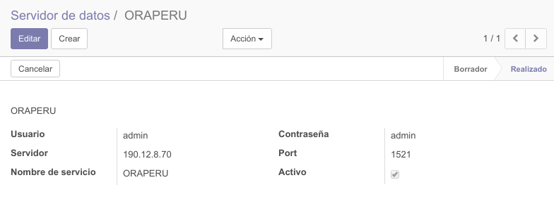
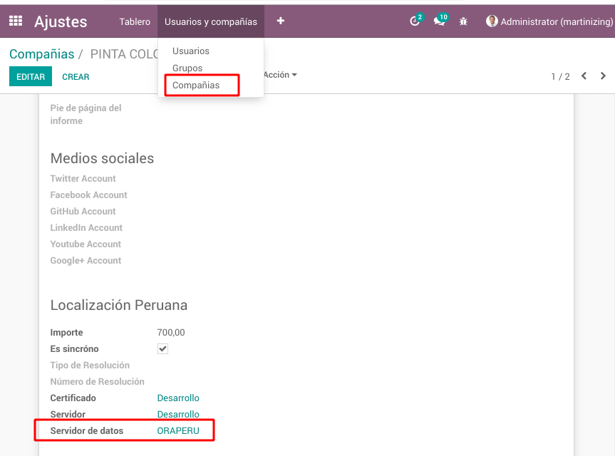
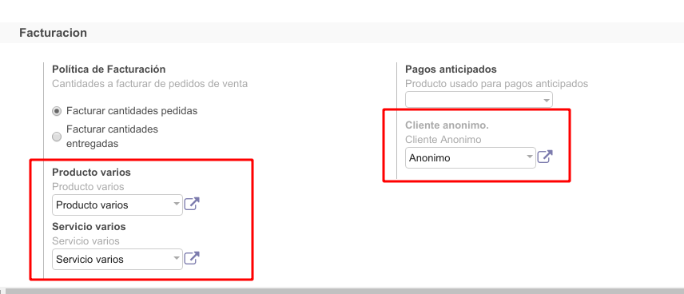
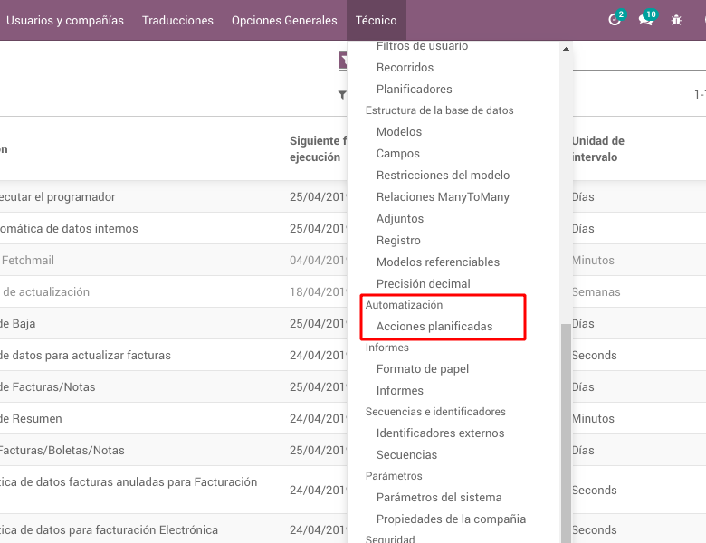
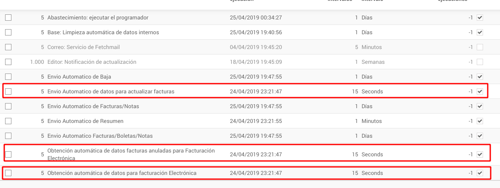
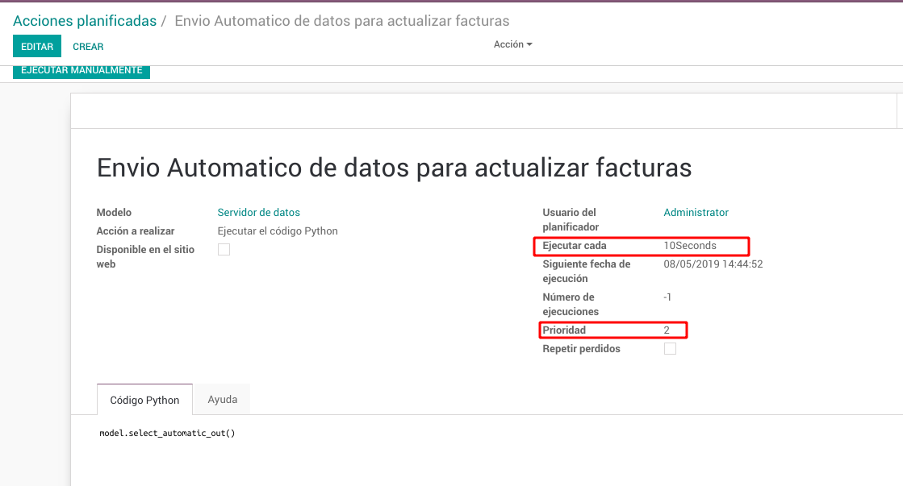

# Syncronizar datos desde DB Oracle
Instalar libreria cx_Oracle

pip3.5 install cx_oracle.

Configuración:
---------------

1. Registrar los datos del acceso a la instancia oracle:

2. Vincular los datos de la instancia Oracle con la compañia:

3. Registro de Usuario anonimo, producto y servicio varios:

4. Revisar que existan 3 acciones planificadas, si no existen proceder a registrarlos:

Detalle de las acciones planificadas:

Detalle de las acciones planificadas:

